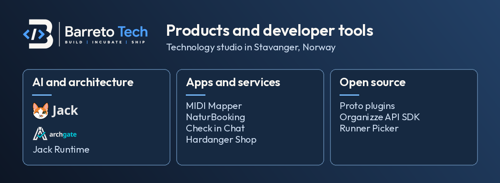

# Barreto Tech

Barreto Tech is a technology studio in Stavanger, Norway. We build products for everyday work and publish the tools we use along the way.

## Products and projects

- [Jack](https://jackforwork.com/) is an AI teammate for everyday work. [Jack Runtime](https://getjack.dev/) connects AI coding tools.
- [Archgate](https://archgate.dev/) turns software architecture decisions into rules developers and coding agents can follow.
- [MIDI Mapper](https://midi-mapper.com/) turns MIDI controllers into programmable macro pads.
- [NaturBooking](https://naturbooking.com/), [Check in Chat](https://app.checkin.chat/), and [Hardanger Shop](https://hardanger.shop/) cover tourism, hospitality, and regional commerce.

## Open-source tools

| Repository | What it does |
| --- | --- |
| [Proto Claude Code Plugin](https://github.com/BarretoTech/proto-claude-code-plugin) | Manage Claude Code installations and versions with Proto. |
| [Proto Azure CLI Plugin](https://github.com/BarretoTech/proto-azure-cli-plugin) | Install and switch between Azure CLI versions with Proto. |
| [Organizze API SDK](https://github.com/BarretoTech/organizze-api-sdk) | Work with the Organizze finance API using OpenAPI. |
| [Runner Picker](https://github.com/BarretoTech/runner-picker) | Select runner pools for GitHub Actions workflows. |

[Browse public repositories](https://github.com/orgs/BarretoTech/repositories) · [Visit Barreto Tech](https://barreto.work/)
